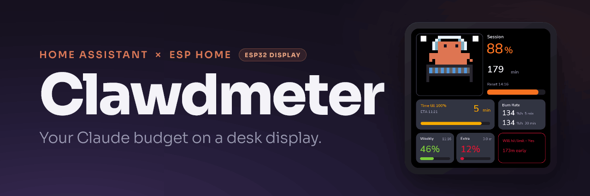
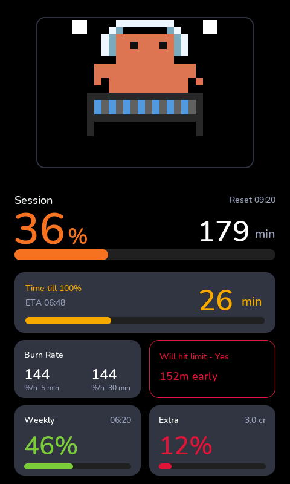
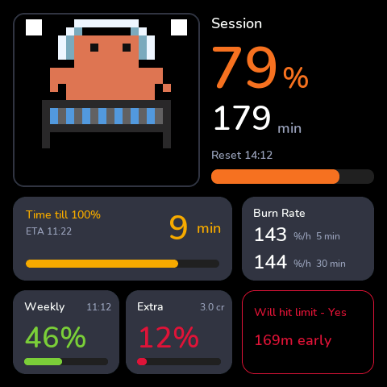
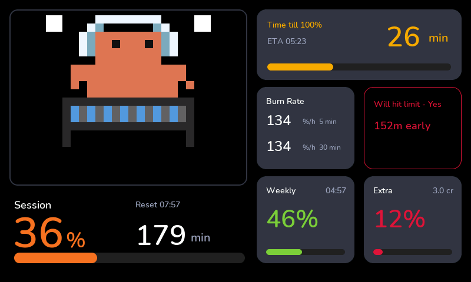
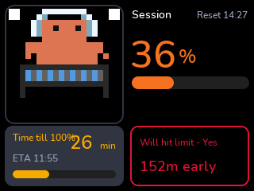

<p align="center">
  
</p>

<h1 align="center">Clawdmeter — esphome-modular-lvgl-buttons</h1>

[](https://opensource.org/licenses/MIT)
[](https://esphome.io)
[](https://www.home-assistant.io/)

<p align="center">
  <a href="https://github.com/corgan2222/esphome-modular-lvgl-buttons"></a>
  <a href="https://github.com/corgan2222/ha-clawdmeter"></a>
  <a href="https://github.com/corgan2222/lovelace-clawdmeter"></a>
</p>

A modular component library for touchscreen smart home panels, built with ESPHome and [LVGL](https://lvgl.io/) for cheap ESP32 displays. This fork adds Clawdmeter, a display that shows your Claude usage.

## What is new in this fork

| Layer | Adds |
|---|---|
| Base, by [agillis](https://github.com/agillis/esphome-modular-lvgl-buttons) | The tile library with every entity type except `media_player`. Flip clock, weather, solar and tides modules. |
| Derek's features, by [derekmcauley7](https://github.com/derekmcauley7/esphome-modular-lvgl-buttons) | The `media_player` tile with its detail page |
| This fork | Clawdmeter: classic and modern layouts, four languages (`en`, `de`, `fr`, `es`), Runway projection, pace frame |

Both upstream layers are included in full. This fork only adds Clawdmeter on top.

## What is new in the latest release

- Weekly view for plans without a five-hour window, such as Ultra. The display switches on its own.
- Durations read as `45 min`, `20h 39m` or `8d 08h` in every layout.
- Six more modern grid configs: three Waveshare P4 DSI kits, Guition JC8012P4A1 V2 and V3, Sunton 8048S043.
- Ten new hardware files, among them the CrowPanel Advanced 10.1" and the Guition JC1060P470 V2.
- New `cover` tile for blinds, shutters, gates and garage doors.
- Weather and tides: Pirate Weather with an AQI pill, and offline tide prediction.
- ESPHome 2026.7.0 or newer is required, 2026.8.0 for the JC8012P4A1 V2 and V3.

## Clawdmeter

Clawdmeter is an animated pixel-art creature with a stats panel. The creature's mood follows how fast you burn tokens. The panel shows session, weekly and extra usage, burn rate, time to 100%, the reset clocks and Runway. Runway answers one question: will you reach the limit before the reset?

| Build | You include | It shows |
|---|---|---|
| All-in-one | `remote.yaml`, once | Creature, session and weekly bars, reset countdowns. Fits any resolution. |
| Grid classic | Single tiles, placed on a grid | Adds extra usage, burn rate, time to 100%, Runway and the pace frame |
| Grid modern | A layout file, picked with `design:` | The grid classic metrics as dark cards, plus history charts. Nine fixed resolutions. |

The pace frame is an optional breathing border around the creature tile on both grid builds. It turns the Runway pace into green, orange or red.

> **Clawdmeter needs a data source.** It only draws Home Assistant entities. The [ha-clawdmeter](https://github.com/corgan2222/ha-clawdmeter) integration provides them, about 29 per Claude account. The `ha_account` substitution binds a config to the slug of that account's device, for example `claude_jane_pro`.

The [Clawdmeter reference](ui/clawdmeter/README.md) covers the data flow, every entity and variable, the animation rules and the weekly view.

### Modern layouts

`design:` picks one of nine modern layouts, the "Modern Dark" look. Each is tuned by hand for one resolution. Here are four. The Clawdmeter reference shows all nine.

| `modern`<br>480×800 | `modern_square`<br>480×480 |
|:---:|:---:|
|  |  |

| `modern_landscape`<br>800×480 | `modern_320x240`<br>320×240, compact |
|:---:|:---:|
|  |  |

`modern_320x240` is compact: it drops the weekly and extra rows. The screenshots are SDL desktop renders with synthetic data.

## Supported boards

These boards ship with a ready Clawdmeter config for all three builds. The second column names the `design:` value of the grid modern config.

| Board | `design:` |
|---|---|
| Guition JC4880P443, 4.3", 480×800 | `modern`, `modern_landscape` |
| Guition JC8012P4A1, 10.1", 800×1280 | `modern_1280` |
| Guition 4848S040, 4.0", 480×480 | `modern_square` |
| Guition JC4827W543, 4.3", 480×272 | `modern_480x272` |
| Guition JC8048W535, 3.5", 320×480 | `modern_320x480` |
| Sunton 2432S028, 2.8", 320×240 | `modern_320x240` |
| Waveshare P4 86 Panel, 86 mm, 720×720 | `modern_720` |
| Waveshare P4 WiFi6 Touch LCD 7, 7.0", 720×1280 | `modern_720x1280` |

These boards have a grid modern config only. It is untested: validated and compiled, but never run on the board.

| Board | `design:` |
|---|---|
| Guition JC8012P4A1 V2 and V3, 10.1", 800×1280 | `modern_1280` |
| Sunton 8048S043, 4.3", 800×480 | `modern_landscape` |
| Waveshare P4 WiFi6 kit + 7-DSI-TOUCH-A, 7.0", 720×1280 | `modern_720x1280` |
| Waveshare P4 WiFi6 kit + 10.1-DSI-TOUCH-A, 10.1", 800×1280 | `modern_1280` |
| Waveshare P4 Module kit + 10.1-DSI-TOUCH-A, 10.1", 800×1280 | `modern_1280` |

The configs are in [`example_code/clawdmeter/`](example_code/clawdmeter/), sorted into `all-in-one/` and `grid/` and named after the board. Only the JC4880P443 portrait config, `design: modern`, runs on a device every day.

The library also supports the boards below. They have no ready Clawdmeter config yet.

| Maker | Boards |
|---|---|
| Waveshare ESP32-S3 | Touch LCD 2.8C, 3.5, 3.5B, 4, 4 V4, 4.3, 7, 7B |
| Waveshare ESP32-P4 | WiFi6 Touch LCD 3.4C, 4B, 7B, 10.1 |
| Guition | JC8048W550, JC1060P470 and JC1060P470C, both also as V2 |
| Sunton | 2432S028R, 4827S032R, 8048S050, 8048S070 |
| Others | Elecrow 7", CrowPanel Advanced 10.1" in two revisions, ESP32-S3-BOX-3, LilyGO T-Display S3 |

**Pick the hardware file that matches your panel revision.** The JC8012P4A1 and the JC1060P470 exist in several revisions, and each needs its own file. The [board reference](docs/boards.md) tells the revisions apart. It also lists every hardware file with size, resolution and display driver.

## How it works

Each entity type lives in `ui/<type>/`:

| File | Provides |
|---|---|
| `local.yaml` | Tile for an ESPHome component on the same device |
| `remote.yaml` | Tile for a Home Assistant entity |
| `detail.yaml` | Full-screen detail page, complex types only |

Your device YAML includes one hardware file, the shared infrastructure and one `!include` per tile. Globals, scripts and detail pages are wired automatically. [ARCHITECTURE.md](ARCHITECTURE.md) explains the design.

## Installation

The shortest path that works today:

1. In Home Assistant 2026.11 or newer, install the ha-clawdmeter integration and connect your Claude account. Note the device slug, for example `claude_jane_pro`.
2. Clone this repository into your ESPHome config directory. With the ESPHome Device Builder add-on that is `/config/esphome/`.

   ```bash
   cd /config/esphome
   git clone https://github.com/corgan2222/esphome-modular-lvgl-buttons.git
   ```

3. Copy the config for your board from `example_code/clawdmeter/all-in-one/` (the simplest) or `example_code/clawdmeter/grid/` into the config directory itself, next to the cloned folder. Set `ha_account` in its `substitutions:` block.
4. Add five keys to `secrets.yaml`: `wifi_ssid`, `wifi_password`, `ap_password`, `latitude`, `longitude`.
5. Install from the Device Builder. The first flash goes over USB. Then add the discovered device in Home Assistant.

For a tile panel without Clawdmeter, skip step 1 and copy a config from `example_code/modular/`.

```text
/config/esphome/
├── esphome-modular-lvgl-buttons/    this repository, the whole folder
├── secrets.yaml
└── my-panel.yaml                    your copy of an example config
```

**Keep the folder name `esphome-modular-lvgl-buttons`, and do not point `packages:` at the GitHub URL.** Configs, fonts and images use that literal path, which only resolves from your config directory.

You need ESPHome 2026.7.0 or newer.

There is no prebuilt firmware and no browser installer. Board, Wi-Fi and Claude account are set at compile time.

<details>
<summary>Each step in detail, and the ESPHome CLI</summary>

- Slug: in Home Assistant open Developer Tools, then States. Filter for `sensor.claude` and take the common prefix before `_session_usage`.
- Terminal: step 2 runs in a terminal, for example the Advanced SSH & Web Terminal add-on.
- No terminal: choose Code, then Download ZIP on GitHub. Copy the unzipped folder into `/config/esphome/` with the Samba, Studio Code Server or File editor add-on. Rename it to `esphome-modular-lvgl-buttons`, without the `-main` suffix.
- Device config: rename your copy, for example to `my-panel.yaml`. Edit only its `substitutions:` block: the `ha_account` slug and the board rotation.
- Secrets: in the Device Builder open Secrets in the three-dot menu at the top right. This writes `/config/esphome/secrets.yaml`, where the includes look for it.

  ```yaml
  wifi_ssid: "your-ssid"
  wifi_password: "your-wifi-password"
  ap_password: "your-fallback-ap-password"
  latitude: 0.0000
  longitude: 0.0000
  ```

- Install: your config shows as a card in the Device Builder. Choose Install in its three-dot menu. For the first flash, connect the board by USB to the Home Assistant host. Later installs can go wirelessly.
- Update: run `cd /config/esphome/esphome-modular-lvgl-buttons && git pull`, then install the device again.

With the ESPHome CLI the steps are the same:

```bash
cd /config               # or wherever your ESPHome configs live
git clone https://github.com/corgan2222/esphome-modular-lvgl-buttons.git
# create secrets.yaml next to the cloned folder, copy an example config, then:
esphome run my-panel.yaml
```

</details>

## Build your own panel

Clawdmeter is one module. The library underneath builds any tile panel from these entity types:

| Type | Detail page | Notes |
|---|---|---|
| `light` | yes | RGB, CCT and brightness, auto-detected |
| `switch` | no | Any toggleable Home Assistant entity |
| `sensor` | no | Configurable unit and decimal precision |
| `binary_sensor` | no | Read-only: door, motion, leak |
| `text_sensor` | no | Any string state or attribute |
| `button` | no | Momentary press, also for `script.*` and `scene.*` |
| `sensor_button` | no | Sensor value plus a timed toggle, such as temperature and heating boost |
| `climate` | yes | Arc setpoint, dropdowns for mode, fan and swing, auto-detected |
| `cover` | yes | Blinds, shutters, gates, garage doors. Stateful or stateless, auto-detected |
| `media_player` | yes | Transport controls, volume, progress, optional PIN lock |

Every type has a `local` and a `remote` variant, except `media_player`, which is remote only. Planned: `fan`, `number` (setpoints, PID targets), `select` (operating modes, option lists) and `lock` (with a PIN pad detail page).

Each type documents its variables and examples in a `README.md` in its folder under [`ui/`](ui/). `sensor_button` lists them in the header of `ui/sensor_button/remote.yaml`.

The [tile panel guide](docs/tile-panels.md) covers tile variables, grid layout, pages, theme and icons. It also covers your own images, the SDL desktop preview and the feature modules for clock, weather, solar and tides.

## License

MIT, see [LICENSE](LICENSE).
